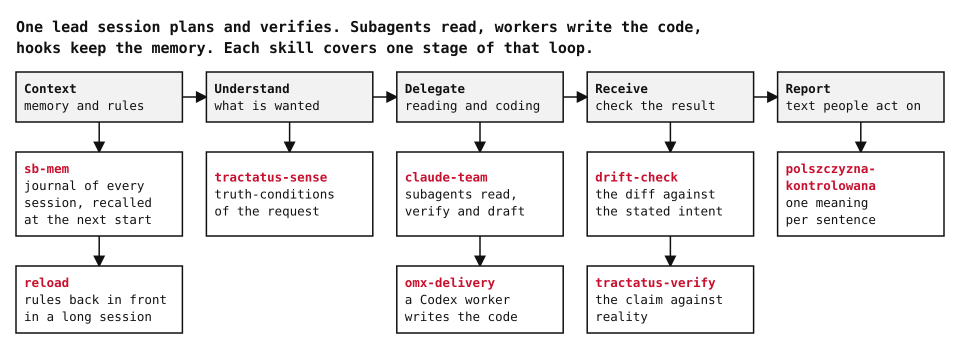
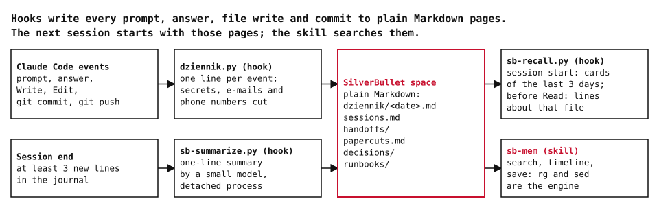
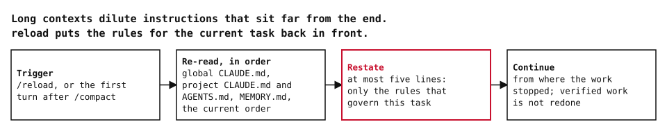
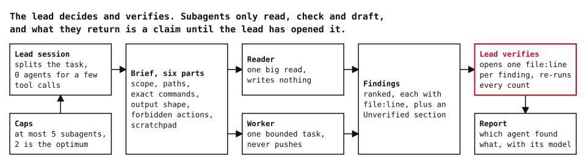
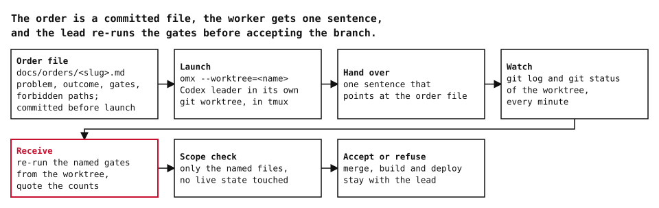
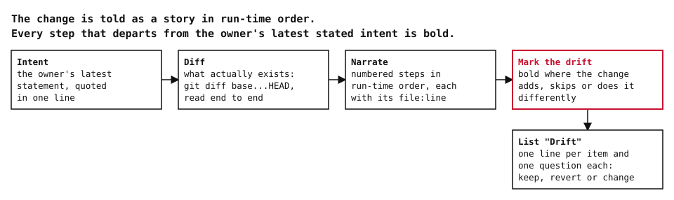
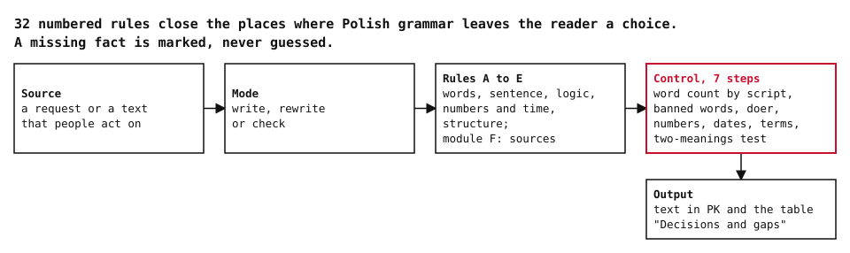

# claude-code-skills

Skills I wrote for my own Claude Code setup. One lead session plans and verifies, subagents
read, workers write the code, and hooks keep the memory.



| Skill | Runs when | What it does |
|---|---|---|
| [`sb-mem`](#sb-mem) | every session, through hooks | Keeps a journal of each session in plain Markdown and gives it back at the next start. |
| [`reload`](#reload) | a long session drifts, or after `/compact` | Re-reads the rule files and restates the rules that govern the current task. |
| [`claude-team`](#claude-team) | before a subagent is spawned | Sets roles, caps, the six-part brief and how to verify what comes back. |
| [`omx-delivery`](#omx-delivery) | code is handed to a Codex worker | Order file, launch in a git worktree, one-sentence handover, receiving on re-run gates. |
| [`drift-check`](#drift-check) | before a branch goes to the owner | Narrates what the diff does and marks every place it departs from the stated intent. |
| [`polszczyzna-kontrolowana`](#polszczyzna-kontrolowana) | Polish text that people act on | Controlled Polish: 32 numbered rules that leave each sentence one meaning. |

Two more skills live in [tractatus-skills](https://github.com/maciejszulia/tractatus-skills):
`tractatus-sense` (truth-conditions of a request) and `tractatus-verify` (truth table for a claim).

The skills are written for my environment: paths, tools and dates of my own rules. Adapt them
before use.

## sb-mem

Session memory without a database. Three hooks write and read a journal in a
[SilverBullet](https://silverbullet.md) space; any folder of Markdown files works
(`SB_MEM_SPACE`).



- `dziennik.py` appends one line for each prompt, final answer, commit, push, delegation and
  skill call, and one line per written file per session. Secrets, e-mail addresses and phone
  numbers are cut before the line is written.
- `sb-summarize.py` runs at session end when the session has at least 3 new lines. A detached
  process asks a small model for a one-line summary and appends it to the journal.
- `sb-recall.py` prints cards of the sessions from the last 3 days at session start. Before a
  `Read` it adds up to 5 lines from those pages that mention the file.
- The skill is the read side: `search`, `timeline` and `save`. `rg` and `sed` are the whole
  search engine.

A journal line looks like this:

```
- 14:02:11 | lead 3f9a1c2e | commit: Fix the date parser for ISO week numbers
```

Files: [`SKILL.md`](skills/sb-mem/SKILL.md), [`hooks/`](skills/sb-mem/hooks),
[`settings-hooks.json`](skills/sb-mem/settings-hooks.json). Requirements: Python 3, ripgrep,
and the `claude` CLI for the summaries.

```sh
cp skills/sb-mem/hooks/*.py ~/.claude/hooks/
# merge skills/sb-mem/settings-hooks.json into the "hooks" key of ~/.claude/settings.json
ln -s "$PWD/skills/sb-mem" ~/.claude/skills/sb-mem
```

## reload

Long contexts dilute instructions that sit far from the end. `reload` reads the global
`CLAUDE.md`, the project's `CLAUDE.md` and `AGENTS.md`, the memory index and the current
order, then writes at most five lines: only the rules that bear on the task at hand. Work
that was already verified is not redone.



File: [`SKILL.md`](skills/reload/SKILL.md).

## claude-team

How the lead session works with its own subagents. The lead decides, splits, briefs,
verifies and reports. A reader does one big read and writes nothing. A worker does one
bounded task and never pushes. The caps: at most 5 subagents, 2 is the optimum, and 0 when
a few tool calls answer the question.



Every agent gets the same six-part brief: scope, paths, exact commands, output shape,
forbidden actions, scratchpad. What comes back is a claim: the lead opens at least one
`file:line` per finding and re-runs every count before quoting it.

File: [`SKILL.md`](skills/claude-team/SKILL.md).

## omx-delivery

Hands a coding task to a worker running on OMX (oh-my-codex, an orchestration layer on top of
OpenAI's Codex CLI). The order is a committed Markdown file, because a git worktree contains
only committed files. The worker gets one sentence that points at that file. The lead watches
`git log` and `git status` of the worktree, then re-runs the gates named in the order before
accepting the branch. Merge, build and deploy stay with the lead.



The skill also lists the failure signals met in practice and what each one means.

Files: [`SKILL.md`](skills/omx-delivery/SKILL.md), [`evals/`](skills/omx-delivery/evals).

## drift-check

After a long session the change and the owner's picture of it can differ. `drift-check`
quotes the owner's latest statement of intent, reads the real diff, and tells the change as
numbered steps in the order things happen at run time, each with its `file:line`. Every step
that adds, skips or changes something the intent did not ask for is bold. The pass is
read-only and ends with one question per drift: keep, revert or change.



File: [`SKILL.md`](skills/drift-check/SKILL.md).

## polszczyzna-kontrolowana

Controlled Polish (PK) for instructions, procedures, terms, specifications and reports.
Polish grammar leaves the reader a choice in fixed places: no articles, free word order, the
genitive, conjunctions, interval bounds. Each of the 32 rules closes one of them. The skill
has three modes: write, rewrite, check. A missing number, date or doer is marked in the text
and listed in a table, never guessed.



File: [`SKILL.md`](skills/polszczyzna-kontrolowana/SKILL.md). The rule set, the paper and the
measurement data live in their own repository:
[polszczyzna-kontrolowana](https://github.com/maciejszulia/polszczyzna-kontrolowana).

## Install

```sh
git clone https://github.com/maciejszulia/claude-code-skills.git
ln -s "$PWD/claude-code-skills/skills/drift-check" ~/.claude/skills/drift-check
```

Repeat the link for each skill you want. Claude Code picks them up from `~/.claude/skills`
in the next session.

## Diagrams

The diagrams are generated by [`tools/render_diagrams.py`](tools/render_diagrams.py), standard
library only. On every run the script asserts three things: each node has at least one edge,
each edge segment is horizontal or vertical, and each line of text fits inside its box.
It also renders the two diagrams used in tractatus-skills.

```sh
python3 tools/render_diagrams.py
```
