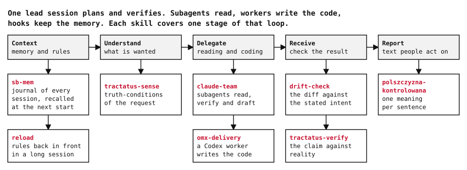
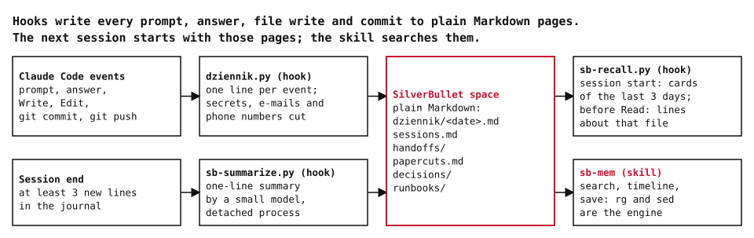
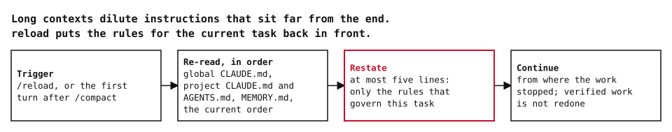
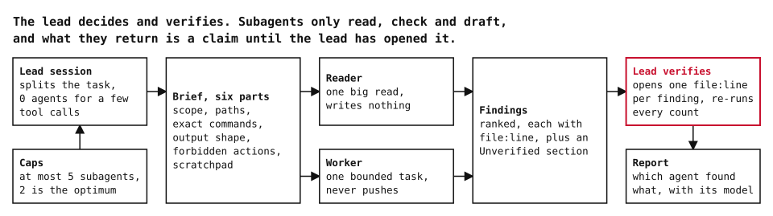
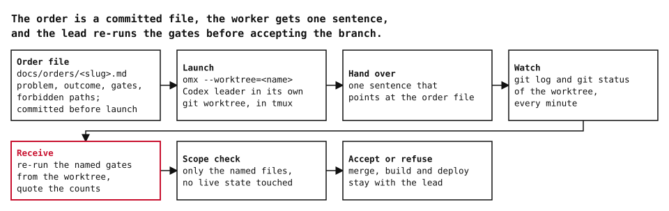
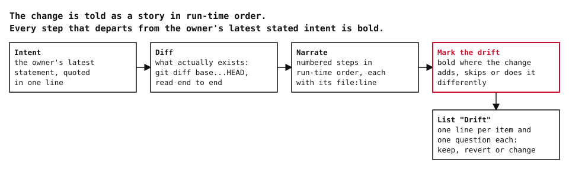
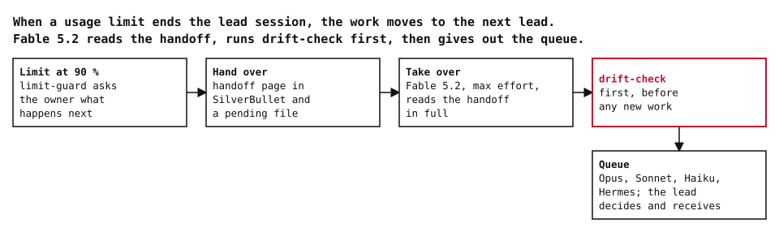
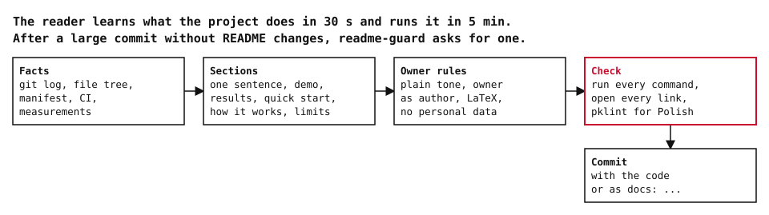
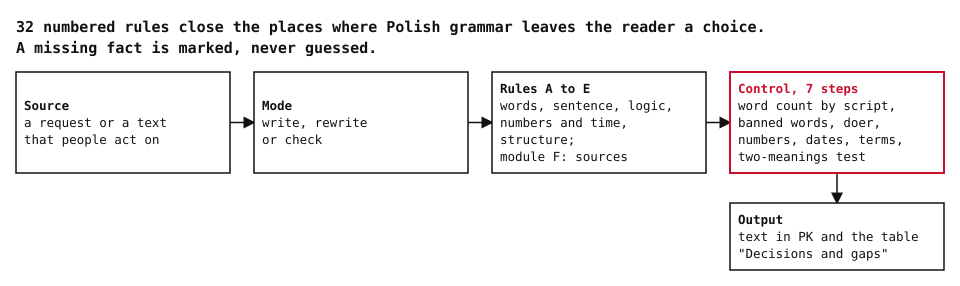
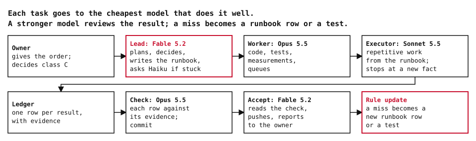

# claude-code-skills

Skills I wrote for my own Claude Code setup. A lead session plans, decides and verifies, a
second session writes the code, subagents run only on my order, and hooks keep the memory.



| Skill | Runs when | What it does |
|---|---|---|
| [`sb-mem`](#sb-mem) | every session, through hooks | Keeps a journal of each session in plain Markdown and gives it back at the next start. |
| [`reload`](#reload) | a long session drifts, or after `/compact` | Re-reads the rule files and restates the rules that govern the current task. |
| [`claude-team`](#claude-team) | before work is split or an agent is spawned | How the pair of sessions works and how a fleet works on my order: roles, caps, the six-part brief, verification of what comes back. |
| [`omx-delivery`](#omx-delivery) | paused since 2026-10-06; code is handed to a Codex worker | Order file, launch in a git worktree, one-sentence handover, receiving on re-run gates. |
| [`drift-check`](#drift-check) | before a branch goes to the owner, and every morning | Narrates what the diff does and marks every place it departs from the stated intent; a second mode checks every open session. |
| [`lead-handoff`](#lead-handoff) | a usage limit ends the lead session, or a session of the pair has at most 15 % of its context free | Writes a handoff page; the next lead marks the takeover, runs drift-check, then gives the computing and coding tasks to the second session. |
| [`github-readme`](#github-readme) | a repository is created or a large commit lands | Rules and checks for a README a recruiter reads in 30 s; a hook asks for an update after a large commit. |
| [`boldness-brains`](#boldness-brains) | at session start and when I ask where I stand | Counts the closing actions that wait for me and suggests at most 3 of them before more tooling. |
| [`polszczyzna-kontrolowana`](#polszczyzna-kontrolowana) | Polish text that people act on | Controlled Polish: 32 numbered rules that leave each sentence one meaning. |

Two more skills live in [tractatus-skills](https://github.com/maciejszulia/tractatus-skills):
`tractatus-sense` (truth-conditions of a request) and `tractatus-verify` (truth table for a claim).

The skills are written for my environment: paths, tools and dates of my own rules. Adapt them
before use.

## sb-mem

Session memory without a database. Three hooks write and read a journal in a
[SilverBullet](https://silverbullet.md) space; any folder of Markdown files works
(`SB_MEM_SPACE`).



- `dziennik.py` appends one line for each prompt, final answer, commit, push, delegation and
  skill call, and one line per written file per session. Secrets, e-mail addresses and phone
  numbers are cut before the line is written.
- `sb-summarize.py` runs at session end when the session has at least 3 new lines. A detached
  process asks a small model for a one-line summary and appends it to the journal.
- `sb-recall.py` prints cards of the sessions from the last 3 days at session start. Before a
  `Read` it adds up to 5 lines from those pages that mention the file.
- The skill is the read side: `search`, `timeline` and `save`. `rg` and `sed` are the whole
  search engine.

A journal line looks like this:

```
- 14:02:11 | lead 3f9a1c2e | commit: Fix the date parser for ISO week numbers
```

Files: [`SKILL.md`](skills/sb-mem/SKILL.md), [`hooks/`](skills/sb-mem/hooks),
[`settings-hooks.json`](skills/sb-mem/settings-hooks.json). Requirements: Python 3, ripgrep,
and the `claude` CLI for the summaries.

```sh
cp skills/sb-mem/hooks/*.py ~/.claude/hooks/
# merge skills/sb-mem/settings-hooks.json into the "hooks" key of ~/.claude/settings.json
ln -s "$PWD/skills/sb-mem" ~/.claude/skills/sb-mem
```

## reload

Long contexts dilute instructions that sit far from the end. `reload` reads the global
`CLAUDE.md`, the project's `CLAUDE.md` and `AGENTS.md`, the memory index and the current
order, then writes at most five lines: only the rules that bear on the task at hand. Work
that was already verified is not redone.



File: [`SKILL.md`](skills/reload/SKILL.md).

## claude-team

How the work is split. Two sessions form a pair. The lead session (Fable 5.2, max effort)
plans, decides, writes text, merges, receives the work and reports. The second session
(Opus 5.5, max effort) computes, measures, proves, writes code and tests. Each finished task
goes to the other session for review before I see it. Decisions have three classes: one
session settles class A, two agreeing votes settle class B, and class C stays with me.

A fleet of subagents runs only on my order in the chat of that session; without the order the
number of subagents is 0. On an order the caps hold: at most 5 subagents through the Agent
tool, 2 is the optimum, 0 when at most 5 tool calls answer the question, and more than 5 only
when the order names the number. A reader does one big read and writes nothing. A worker does
one bounded task and never pushes.



Every agent gets the same six-part brief: scope, paths, exact commands, output shape,
forbidden actions, scratchpad. What comes back is a claim: the lead opens at least one
`file:line` per finding and re-runs every count before quoting it.

File: [`SKILL.md`](skills/claude-team/SKILL.md).

## omx-delivery

Paused since 2026-10-06: I do not work with Codex and OMX for now, and the skill says so in its
first lines. It hands a coding task to a worker running on OMX (oh-my-codex, an orchestration
layer on top of OpenAI's Codex CLI). The order is a committed Markdown file, because a git worktree contains
only committed files. The worker gets one sentence that points at that file. The lead watches
`git log` and `git status` of the worktree, then re-runs the gates named in the order before
accepting the branch. Merge, build and deploy stay with the lead.



The skill also lists the failure signals met in practice and what each one means.

Files: [`SKILL.md`](skills/omx-delivery/SKILL.md), [`evals/`](skills/omx-delivery/evals).

## drift-check

After a long session the change and the owner's picture of it can differ. `drift-check`
quotes the owner's latest statement of intent, reads the real diff, and tells the change as
numbered steps in the order things happen at run time, each with its `file:line`. Every step
that adds, skips or changes something the intent did not ask for is bold. The pass is
read-only and ends with one question per drift: keep, revert or change. In a pair the other
session reviews the report before I see it.



A second mode checks every Claude Code session that is open on the machine, one report per
morning. `open_sessions.py` reads the session registry (`~/.claude/sessions/*.json`; the `*.key`
files are never opened), `session_digest.py` turns each transcript into the owner's prompts, the
agents, commits, written files and final answers, and `grep_transcript.py` finds a quote with
its time. Each claim is then checked against git and the files. The report ends with questions
to the owner, each with a decision class (A, B or C), a recommendation and a deadline. The
scripts use the standard library only; each has `--selftest`.

Files: [`SKILL.md`](skills/drift-check/SKILL.md), [`scripts/`](skills/drift-check/scripts).

## lead-handoff

A usage limit can end the lead session in the middle of the work, and a long session can run
out of context. In the hand-over mode the
outgoing lead writes a handoff page in SilverBullet: the goal, the owner's orders of the day,
the state, every repository with its newest commit, the queue with a completion criterion per
task, the steps that wait for the owner, and the limits. The page path goes to a pending file.
In the take-over mode the incoming lead (Fable 5.2 at max effort) reads the page, marks the
takeover so that exactly one lead works the queue, runs `drift-check` before any new work, and
gives the computing, measuring and coding tasks to the second session; a subagent needs my
order (`claude-team`). When a session of the pair has at most 15 % of its context free,
`pair.py restart` has Sonnet 5.5 write the handoff of the pair and starts new sessions.
Two hooks drive it: `limit-guard` asks the owner what to do at 90 % of the
5-hour or 7-day limit and asks for `drift-check` after the reset; `lead-takeover` reminds a new
session of a pending handoff. When an `ntfy-push` command exists, `limit-guard` also sends one
phone alarm per window.



Files: [`SKILL.md`](skills/lead-handoff/SKILL.md) and the hooks in
[`skills/lead-handoff/hooks/`](skills/lead-handoff/hooks/). In the take-over mode the new lead
also reviews every skill, hook and MCP server that another model wrote since the last review.

## github-readme

A README is the first thing a recruiter or an engineer reads. The skill collects facts from the
repository (history, file tree, manifest, CI, measurements), writes the sections in a fixed
order (one sentence, demo, results, quick start, how it works, limits, licence), applies the
owner's rules (plain tone, the owner as author, LaTeX for formulas, no personal data), and checks
the result: every quick-start command run in a clean clone, every link opened, Polish text passed
through `pklint`, and a README test that compares each number describing the code with the
code. In a pair the other session reviews the text before the commit. The hook `readme-guard` runs after each commit; when a commit changes at least
200 lines, adds a top-level directory or touches a manifest, and leaves the README untouched, it
asks for an update.



Files: [`SKILL.md`](skills/github-readme/SKILL.md) and the hook in
[`skills/github-readme/hooks/`](skills/github-readme/hooks/).

## boldness-brains

A chart called "The boldness-to-brains ratio" has brains on the horizontal axis and boldness on
the vertical one. Tooling moves a point to the right; a closing action (a sent application, a
click, a signature, a decision) moves it up. The skill counts the closing actions that wait for
me in three sources (job-application ledgers, the order database, the newest drift-check
report), sorts them by the minutes they need and suggests at most 3. When I order a tool while
at least 3 closing actions wait, it adds one sentence with that number and then does the work.
The percentages on the plane and the minutes are the agent's estimates, not measurements.

File: [`SKILL.md`](skills/boldness-brains/SKILL.md). The hook `boldness-nudge.py` reports the
counts at session start (see [Hooks](#hooks)).

## polszczyzna-kontrolowana

Controlled Polish (PK) for instructions, procedures, terms, specifications and reports.
Polish grammar leaves the reader a choice in fixed places: no articles, free word order, the
genitive, conjunctions, interval bounds. Each of the 32 rules closes one of them. The skill
has three modes: write, rewrite, check. A missing number, date or doer is marked in the text
and listed in a table, never guessed.



File: [`SKILL.md`](skills/polszczyzna-kontrolowana/SKILL.md). The rule set, the paper and the
measurement data live in their own repository:
[polszczyzna-kontrolowana](https://github.com/maciejszulia/polszczyzna-kontrolowana).

## Model routing



Each task goes to the cheapest model that does it well, and a stronger model reviews the result:
Fable 5.2 leads, Opus 5.5 computes and checks, Sonnet 5.5 executes from a runbook, Haiku gives a
hunch when no test exists. Roles, rules and one day in numbers:
[docs/model-routing.md](docs/model-routing.md) ([po polsku](docs/model-routing.pl.md)).

## Agent fleet, lifecycle and zero trust

A 2-agent fleet (a Haiku collector, a Sonnet worker, the lead merges) on a repository with 4,188 open pull
requests: the measured lifecycle of each agent, a tamper-evident event journal, a truth table of where the setup
stands on zero trust, and which parts of a zero-trust stack for agent networks pay off at this scale:
[docs/agent-fleet-zero-trust.md](docs/agent-fleet-zero-trust.md).

## Pair watch

Two Claude Code sessions can work as a pair: a lead that plans and a worker that computes.
[`tools/pair-watch/pair.py`](tools/pair-watch/pair.py), standard library only, keeps the pair
going when context runs out. `context` prints the free context of a session from the `usage`
field of its transcript and exits 2 at 15 % or less. `watch` checks the other session every 30
seconds and prints one line per event: process gone, API error, usage limit, context limit,
compaction, low context, busy for 15 minutes without a new entry; it never prints transcript
text. `consolidate` has a model (Sonnet by default) write a handoff page from both transcripts,
with the session-only crons to recreate. `start` opens the new pair in tmux; without a
permission mode chosen by you it only prints the commands. `restart` runs both.

```sh
python3 tools/pair-watch/pair.py --selftest
python3 tools/pair-watch/pair.py context ~/.claude/projects/<project>/<session>.jsonl
```

## Gitea mirror

[`tools/gitea-middle-remote/gitea_mirror.py`](tools/gitea-middle-remote/gitea_mirror.py) adds a local Gitea as the
third push URL of each clone that pushes to GitHub and GitLab. `--dry-run` prints the plan, `--apply` creates the
Gitea repository with the GitHub visibility, appends the push URL after GitHub and GitLab, and pushes every branch
and tag to Gitea only, `--compare` checks the default branch hash. The token is read from a file and sent only in
an HTTP header.

## Nightly consolidation

[`tools/second-brain-nightly/nightly.py`](tools/second-brain-nightly/nightly.py) consolidates a SilverBullet
space at night. `--dry-run` prints four lists and changes nothing: files to commit (Markdown pages and neurophify
outputs, by name), skipped files (a secret pattern is logged by file name only), the 20 heaviest pages by
neurophify weight for Sonnet, and the pages changed within a day for Haiku. `--apply` writes `CORE.md` and a daily
digest with one tool-less `claude -p` call each, commits the listed files and pushes. The runit `run` file next to
it starts the job at 03:00 and is meant to be reviewed before installing.

## Hooks

Hooks that belong to no single skill live in [`hooks/`](hooks).

| Hook | Event | What it does |
|---|---|---|
| [`link-guard.py`](hooks/link-guard.py) | `Stop` | Blocks an answer once when it says something was saved (`zapisane`, `zapisałem`) and carries no link. A link is a path with a line number or a URL. `--selftest` runs 8 cases. |
| [`boldness-nudge.py`](hooks/boldness-nudge.py) | `SessionStart` | Counts the job-application cards and the order components that wait for me and prints one context line; prints nothing when both counts are 0. Read-only. `--selftest` builds a temporary ledger. |
| [`agent-journal.py`](hooks/agent-journal.py) | every event (proposed, not installed) | Appends 1 JSON line per event with the hash of the line before, so an edited or deleted line breaks the chain. `--verify` checks a day, `--lifecycle` prints each subagent's start, stop and minutes, `--self-check` tampers in a temporary folder. Never blocks a tool call. |

```sh
cp hooks/link-guard.py ~/.claude/hooks/
# then add a Stop hook with the command: python3 ~/.claude/hooks/link-guard.py
cp hooks/boldness-nudge.py ~/.claude/hooks/
# then add a SessionStart hook with the command: python3 ~/.claude/hooks/boldness-nudge.py
cp hooks/agent-journal.py ~/.claude/hooks/
# then add it under SessionStart, UserPromptSubmit, PreToolUse, PostToolUse, PostToolUseFailure,
# SubagentStart, SubagentStop, Stop and SessionEnd: python3 ~/.claude/hooks/agent-journal.py
```

### Every hook my sessions run

Twelve hooks are wired in my `settings.json` (counted on 2026-11-16). Eight of them are in this repository.

| Hook | Event | What it does | Source |
|---|---|---|---|
| `sb-recall.py` | `SessionStart`, `PreToolUse` | Gives the session the journal of earlier sessions, and the notes about a file before the file is read. | [`skills/sb-mem/hooks/`](skills/sb-mem/hooks) |
| `dziennik.py` | `UserPromptSubmit`, `PostToolUse`, `Stop` | Writes the journal of the session into the SilverBullet space. | [`skills/sb-mem/hooks/`](skills/sb-mem/hooks) |
| `sb-summarize.py` | `SessionEnd` | Has a small model summarise the session for the journal. | [`skills/sb-mem/hooks/`](skills/sb-mem/hooks) |
| `lead-takeover.py` | `SessionStart` | Reminds a new session of a pending lead handoff. | [`skills/lead-handoff/hooks/`](skills/lead-handoff/hooks) |
| `limit-guard.py` | `UserPromptSubmit`, `PostToolUse` | Asks me at 90 % of a usage limit whether the session continues or hands over. | [`skills/lead-handoff/hooks/`](skills/lead-handoff/hooks) |
| `readme-guard.py` | `PostToolUse` | Asks for a README update after a large commit. | [`skills/github-readme/hooks/`](skills/github-readme/hooks) |
| `link-guard.py` | `Stop` | Asks for a link when an answer says something was saved. | [`hooks/`](hooks) |
| `boldness-nudge.py` | `SessionStart` | Counts the closing actions that wait for me. | [`hooks/`](hooks) |
| `claude-guard.py` | `PreToolUse` | Blocks dangerous shell commands: `rm -rf` outside safe zones, a force push, `git reset --hard`, a bare `git stash`, removal of another session's worktree or branch. | not published yet |
| `secrets-guard.sh` | `PreToolUse` | Blocks access to files with secrets unless I allow it. | not published yet |
| `sb-provenance.py` | `SessionStart`, `PostToolUse`, `SessionEnd` | Adds a provenance footer to each SilverBullet page a session writes: date, model, session, action. | not published yet |
| `doradca.py` | `UserPromptSubmit`, `PreToolUse` | Reminds the session to suggest a fitting way of working (a skill, a hook, a worktree) in one line. | not published yet |

The four unpublished hooks name local paths; a cleaned copy of each follows. The three `sb-mem` hooks in
this repository are newer than the installed ones: they carry `--selftest`.

## MCP servers and plugins

- **MCP servers I run**: `context7` (current library documentation) and `chrome-devtools` (browser
  debugging), both over stdio.
- **MCP server I wrote**: `pk-mcp` in [pk-rewriter](https://github.com/maciejszulia/pk-rewriter), with three
  tools: `pk_lint`, `pk_rewrite` and `pk_rule`.
- **Plugins I use**: `claude-mem` (memory across sessions), `ponytail` (the smallest solution that works) and
  `skill-creator`.
- **Plugin I wrote**: `link-pane`, a pane with the paths and URLs of the newest answer, opened with a click;
  not published yet.

More of my skills live in [book-skills](https://github.com/maciejszulia/book-skills) (six skills from C++ and
mathematics books) and [neurophify](https://github.com/maciejszulia/neurophify) (one skill).

## Install

```sh
git clone https://github.com/maciejszulia/claude-code-skills.git
ln -s "$PWD/claude-code-skills/skills/drift-check" ~/.claude/skills/drift-check
```

Repeat the link for each skill you want. Claude Code picks them up from `~/.claude/skills`
in the next session.

## Diagrams

The diagrams are generated by [`tools/render_diagrams.py`](tools/render_diagrams.py), standard
library only. On every run the script asserts three things: each node has at least one edge,
each edge segment is horizontal or vertical, and each line of text fits inside its box.
It also renders the two diagrams used in tractatus-skills.

```sh
python3 tools/render_diagrams.py
```
