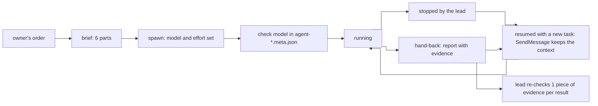
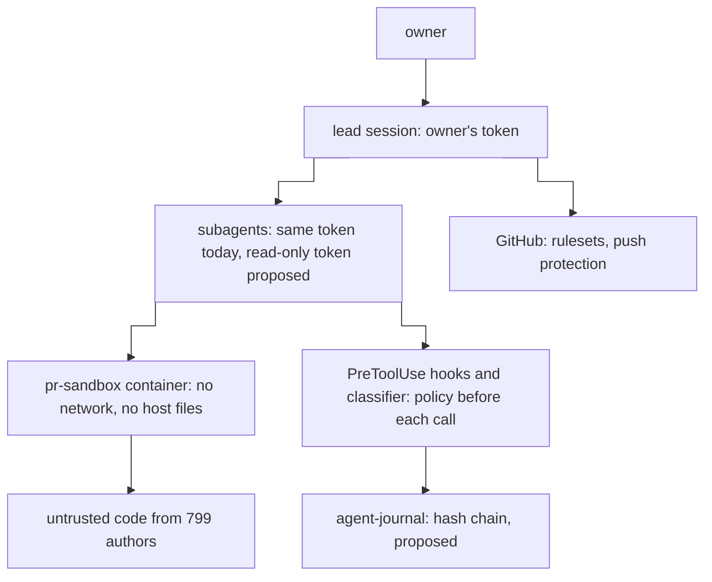

# Agent fleet: lifecycle, event journal and zero trust

Notes from 1 evening (2026-11-23) of running a small agent fleet against
[ItsNotRexed/Leonida](https://github.com/ItsNotRexed/Leonida), a repository with 4,188 open pull requests, and the
controls around the fleet: what runs today, what it does better than the default, what it misses, and which parts of
a zero-trust stack would pay off at this scale. Every number names its measurement.

Legend for the truth tables (from [tractatus-verify](https://github.com/maciejszulia/tractatus-skills)): T = checked
and true, F = checked and false, ? = not checked, with the reason.

## 1. What runs today

| System | How it works | Better than the default because | Missing |
| --- | --- | --- | --- |
| Lead and left hemisphere | 2 long sessions: the lead plans, decides and merges; the other session computes, measures and writes code; each reviews the other's result | A second model reads every result before the owner does | Shared state is text; no lock on files both sessions touch |
| Fleet on the owner's order ([`claude-team`](../skills/claude-team/SKILL.md)) | 0 subagents without an order; a 6-part brief; models checked in `agent-*.meta.json` after start | The cost is known before the start; no agent sprawl | No gate between agents: a worker can start before the collector says the item is free (section 2) |
| Guard hooks (PreToolUse) | Regular expressions block `rm -rf` outside the work folders, `git worktree remove`, `git branch -D`, hard resets | No permission-prompt fatigue for safe commands | Policies are code without a test table |
| Auto-mode classifier | Judges each tool call before it runs | Stopped subagents from posting claims on GitHub in the owner's name | No allowlist per role (collector, worker, lead) |
| Session journal ([`sb-mem`](../README.md#sb-mem)) | Hooks write prompts, answers, delegations and commits as Markdown lines in SilverBullet | Readable and searchable by the owner | Not tamper-evident; no subagent start and stop; no structured fields |
| [pr-sandbox](https://github.com/maciejszulia/pr-sandbox) | Untrusted code runs in Docker with `--network none`, `--cap-drop ALL`, a non-root user, a read-only source | Code from 799 unknown authors never reaches the network or the host files | Shares the host kernel (no gVisor or Firecracker) |
| [Controlled English](https://github.com/maciejszulia/controlled-english) and PK | Rules that leave each sentence 1 meaning; module S for claims, findings and test reports | Briefs and reports between agents have 1 reading | PK has a linter (`pklint`); CE has a word-count script only |
| Privacy plugin | Blocks the owner's e-mail address in requests to outside services | Personal data stays out of URLs and payloads | No general PII or secret filter on tool output |

## 2. Agent lifecycle, measured



The fleet of 2026-11-23 (times CET, from the lead's lifecycle log):

| Agent | Model, effort | Task | Start | End | Result |
| --- | --- | --- | --- | --- | --- |
| collector | Haiku, medium | is the item free? triage of 32 candidates | 21:05:39 | 21:10:22 | item taken by 2 open pull requests; 121,656 tokens, 13 tool calls, 245 s |
| worker | Sonnet, xhigh | fix the item (test first) | 21:05:39 | 21:10:22 | stopped by the lead: the item was taken; 1 local commit, not published |
| worker | Sonnet, xhigh | review the 2 pull requests that fix the item | 21:11:32 | `[TBD]` | `[TBD]` |
| collector | Haiku, medium | read-only zero-trust inventory | 21:26:51 | 21:35 | 74 repositories and 20 hook entries listed; 150,568 tokens, 18 tool calls, 450 s |

Lesson: the worker and the collector started at the same moment, so the worker spent 5 minutes on an item that 2
other contributors had already claimed. **Start the worker only after the collector answers "free".** The collector
costs less than the worker's first 5 minutes.

## 3. An event journal for compliance (proposal)

[`hooks/agent-journal.py`](../hooks/agent-journal.py) is a reference implementation. It is not installed in the
owner's settings; installing it is the owner's decision.

```mermaid
sequenceDiagram
  participant CC as Claude Code session or subagent
  participant J as agent-journal.py (hook)
  participant F as YYYY-MM-DD.jsonl
  CC->>J: hook JSON (SubagentStart, PreToolUse, PostToolUse, SubagentStop, ...)
  J->>F: read the hash of the newest line (file lock)
  J->>F: append 1 line: t, session, event, agent, tool, action, prev, h
  Note over J,F: h = SHA-256 of the line with prev; an edited line breaks every later prev
  CC-->>J: exit 0 always: the journal never blocks a tool call
```

| Field | Content | Privacy rule |
| --- | --- | --- |
| `t` | UTC time, seconds | - |
| `session`, `agent`, `agent_type` | session id (8 characters), subagent id and type from SubagentStart and SubagentStop | - |
| `event`, `tool` | hook event and tool name | - |
| `action` | the command, the file path, the subagent's type, model and task | tokens, `password=` values and e-mail addresses cut out; at most 200 characters |
| prompt | SHA-256 only | the text of a prompt never enters the journal |
| `prev`, `h` | hash of the line before, hash of this line | - |

Commands: `--verify` checks the chain of a day, `--lifecycle` prints 1 line per subagent (start, stop, minutes,
type), `--self-check` writes, verifies and tampers in a temporary folder. Claude Code 2.1.330 sends the hook events
`SubagentStart` and `SubagentStop` with `agent_id` and `agent_type` (checked in the installed binary), so the lifecycle
needs no manual log. A Python start with these imports takes 26 ms (10 runs, 2026-11-23); Python stays, because the
model call that follows each hook takes seconds.

## 4. Zero trust: where the setup stands

Claim under test: "every agent in this setup gets only the access its task needs, and every action can be traced".
The claim splits into elementary propositions (inventory of 2026-11-23, 21:27 to 21:35 CET, read-only; the lead
re-checked rows 4 and 5 by hand):

| # | Proposition | T / F / ? | Evidence |
| --- | --- | --- | --- |
| 1 | Each agent has its own identity on GitHub | F | Every subagent's shell uses the owner's 1 `gh` token |
| 2 | The token holds only the scopes an agent needs | F | Scopes `gist, project, read:org, repo, user, workflow` (`gh auth status`) |
| 3 | Code from unknown authors runs without network and without host files | T | `pr-sandbox/tests/check_sandbox.sh`: "no network, source folder unchanged" |
| 4 | No agent can rewrite or delete `main` of a public repository | F before, T after 21:40 CET | Before: `branches/main/protection` returned 404 for 25 of 26 public repositories. After: 1 ruleset per repository, `rules/branches/<default>` returns `deletion,non_fast_forward` for 25 of 25 |
| 5 | A push with a secret in it is refused | T for 26 of 26 public repositories | Push protection was on for 25; the lead switched it on for `pr-sandbox` (`security_and_analysis`) |
| 6 | Private repositories have the same protection | ? | The API returns 403 for rulesets and branch protection on 43 private repositories (GitHub Free) |
| 7 | The SSH keys on the account are known and needed | ? | The token lacks `read:public_key`; `user/keys` returns 404 |
| 8 | Every tool call passes a policy before it runs | T, partly | 4 PreToolUse hook entries plus the auto-mode classifier; no policy file with tests |
| 9 | Every action is logged where an edit shows | F | The session journal is Markdown; `agent-journal.py` (section 3) is not installed |
| 10 | No script pushes with `--force` | T | 0 hits outside self-tests in the 4 script folders searched; the guard hook log shows only blocked attempts |

Result: rows 1, 2 and 9 are F, rows 6 and 7 are ?, so the claim is not true yet.

What the lead applied on 2026-11-23, because each step changes nothing in the daily workflow:

1. A ruleset "no force push or deletion of the default branch" (`deletion`, `non_fast_forward`, no bypass) on the 25
   public repositories that had no protection. `ksalol-chan` keeps its own branch protection.
2. Secret scanning and push protection on `pr-sandbox`, the only public repository without them.

What the lead proposes, because each step changes how the owner or the agents work:

| Step | Effect | Cost |
| --- | --- | --- |
| A fine-grained token with read-only access for subagents; the owner's token only in the lead | Rows 1 and 2 become T for subagents | Subagents cannot push; the lead pushes, as tonight |
| `gh auth refresh -s read:public_key` (owner, interactive), then review the SSH keys | Row 7 becomes checkable | 1 minute |
| Install `agent-journal.py` for every hook event | Row 9 becomes T | 26 ms per hook call |
| Signed commits (SSH signing) and a ruleset that requires them | Every commit on `main` names its key | Each machine and agent needs the signing key |
| GitHub Pro, or the private repositories on GitLab with protected branches | Row 6 becomes checkable | Money, or a second place to manage |



## 5. The zero-trust stack for agent networks, at this scale

The owner asked which parts of this stack to apply. At 1 laptop, 1 human and at most 5 agents, most layers have no
user yet. The table names the use case each layer would serve here and the event that makes it worth its cost.

| Layer | Components | Use case here | Today | Adopt when |
| --- | --- | --- | --- | --- |
| Workload identity and secrets | SPIRE, HashiCorp Vault, Keycloak or Entra Workload ID, cert-manager | Each agent gets its own short-lived identity instead of the owner's GitHub token | Every agent inherits 1 token of the owner | Agents run unattended on a server, or a second person runs the fleet |
| AI and MCP gateways | LiteLLM proxy, Envoy AI Gateway, Kong, an MCP gateway | 1 place for per-agent budgets and an allowlist of MCP tools per role | Each subagent inherits every MCP tool of the session, mail and calendar included | A subagent gets an MCP tool that writes outside the machine |
| Microsegmentation | Cilium with Hubble, Istio, Linkerd | Network policies in the k3d lab, so an agent pod cannot reach a database pod | `--network none` for untrusted code; no segmentation on the laptop itself | Agents run in Kubernetes next to services with real data |
| Policy engines | OPA (Rego), Cerbos, Cedar | The guard hooks as policy files with a test table: "a subagent MUST NOT call `gh` with a write verb" | Python regular expressions in hooks, plus the classifier | More than 20 rules, or the same rules on 2 machines |
| Semantic guardrails | Llama Guard, NeMo Guardrails, Lakera Guard | A filter for text from 799 strangers (pull request comments, Discord) before an agent acts on it | The model's own instruction boundary | An agent acts on outside text with no human review |
| Observability | OpenTelemetry, Langfuse, Arize Phoenix | 1 trace per task: lead, subagent, tool call, container run, tokens | Markdown journal, claude-mem, subagent meta files | Today: the installed Claude Code reads `CLAUDE_CODE_ENABLE_TELEMETRY` and `OTEL_LOGS_EXPORTER` (found in the binary), so a local OpenTelemetry collector is 1 configuration change |

## 6. Lessons from a repository with 4,000 open pull requests

1. **Test the merge, not only the head.** On `main` at `867d922f`, 15 of 32 candidate test files still failed only
   after the merge (`merge-check`, finished 2026-11-23, 21:19 CET). `merge-bisect` names the merge on `main` that each pull
   request has to catch up with: PR #4673 in 11 steps among 1,176 commits, in 31 s.
2. **Merge in bulk without the API.** A maintainer reported a temporary block by GitHub and planned about 1,000
   merges at once after it (Discord, 16:21 UTC). A local merge train (`git merge-tree` and `git commit-tree` per pull
   request, tests on the train, bisection on failure) ends in 1 push instead of 1,000 merge calls; GitHub marks a pull
   request as merged when its head commit reaches the base branch.
3. **Pick the language by the measured bottleneck.** `git merge-tree` took 0.038 s and the container with the test
   18.25 s for the same pull request, so the orchestrator stays in Python. The project itself merged an optional Rust
   kernel with a byte-exact Python fallback where CPU time is the bottleneck (#6308, texture blocks, 45x to 47x).
4. **Spend tokens on judgement, not on waiting.** The sandbox runs (32 re-checks, 15 bisections) ran as background
   shell loops at 0 tokens; agents only read the results.
5. **Search for duplicates with the same tool the maintainers use.** `gh search prs` returned 0 results for a
   defect that `gh pr list --search` found in 2 open pull requests.
6. **Measure again right before you post.** The open pull request count rose from 3,229 (18:47 CET) to 4,188
   (21:12 CET) in 1 evening.
