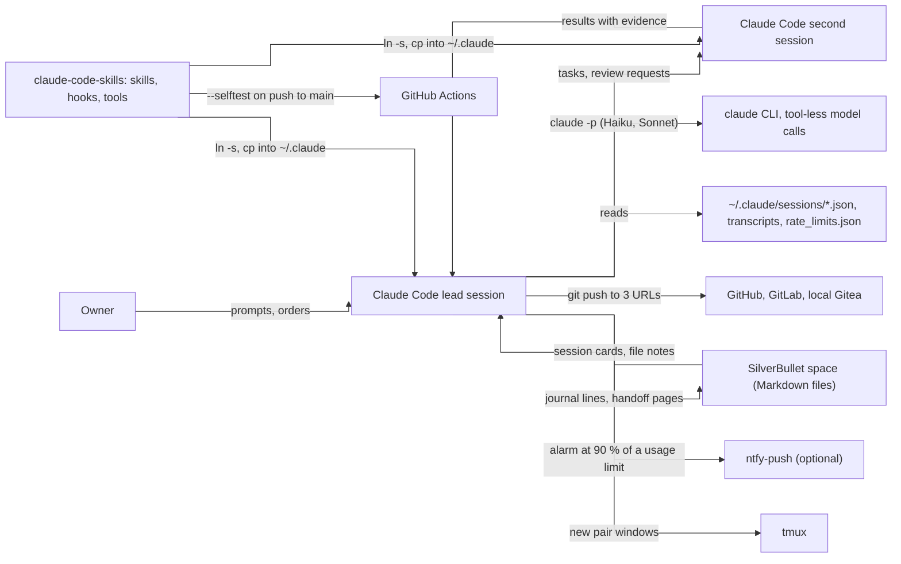
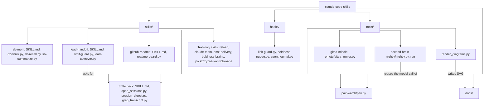
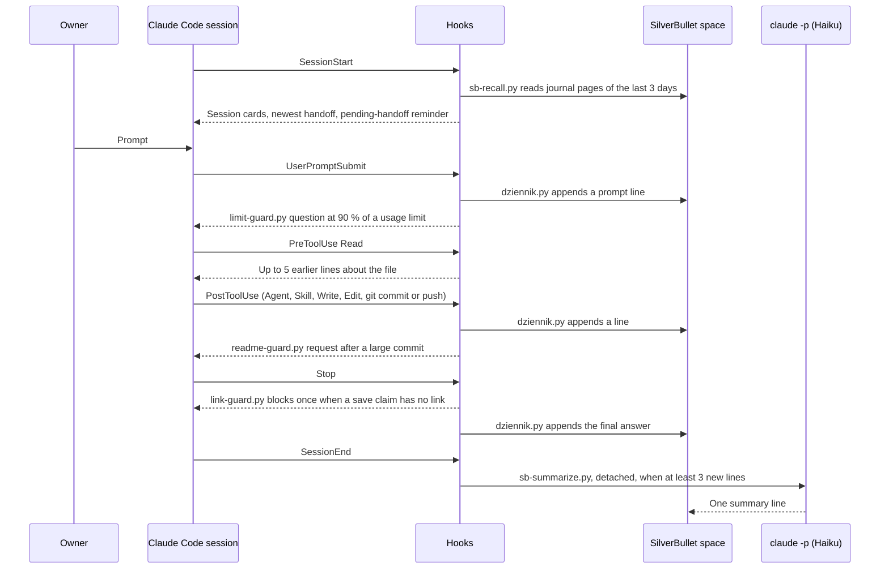

# claude-code-skills: architecture

This document describes the structure of claude-code-skills in the arc42 layout. The repository holds Claude Code skills, the hooks that drive them, and standalone tools for a setup in which two Claude Code sessions work as a pair.

## 1 Introduction and goals

The repository supports a working loop of AI coding sessions: get context, understand the request, delegate, receive the result, report. A lead session plans, decides and verifies; a second session writes the code; subagents run only on the owner's order; hooks keep a session journal.

| Area | Content |
|---|---|
| Skills | `sb-mem`, `reload`, `claude-team`, `omx-delivery` (paused since 2026-10-06), `drift-check`, `lead-handoff`, `github-readme`, `boldness-brains`, `polszczyzna-kontrolowana` |
| Hooks | Journal and recall (`sb-mem`), usage-limit and handoff reminders (`lead-handoff`), README reminder (`github-readme`), `link-guard`, `boldness-nudge`, `agent-journal` |
| Tools | `pair-watch/pair.py`, `gitea-middle-remote/gitea_mirror.py`, `second-brain-nightly/nightly.py`, `render_diagrams.py` |

Quality goals:

1. **No database:** session memory is plain Markdown that `rg` and `sed` search ([ADR 0001](adr/0001-markdown-journal-instead-of-database.md)).
2. **No dependencies:** every script and hook uses the Python standard library only ([ADR 0002](adr/0002-python-standard-library-only.md)).
3. **Testable without the live setup:** each hook and tool script has a self-check flag; CI runs 6 of them ([ADR 0003](adr/0003-selftest-flag-run-in-ci.md)).
4. **Hooks do not break sessions:** a hook error exits 0; only `link-guard` blocks, once per answer.

## 2 Constraints

- Runtime: Claude Code reads skills from `~/.claude/skills/` and runs hooks configured in `~/.claude/settings.json`.
- Language: Python 3, standard library only; shell for the runit `run` file of the nightly job.
- The skills name paths, tools and dates of the owner's environment; the README asks readers to adapt them before use.
- Secrets: hooks cut secrets, e-mail addresses and phone numbers before a journal line is written (`skills/sb-mem/hooks/dziennik.py`); `pair.py` and the drift-check scripts never open the `*.key` files of the session registry; `gitea_mirror.py` sends its token only in an HTTP header.
- The repository has no license file.

## 3 Context and scope

Out of scope: the four hooks that the README lists as "not published yet", the `link-pane` plugin, and the MCP servers the owner runs.

## 4 Solution strategy

- **Skills are text, hooks are code.** A skill is a `SKILL.md` that tells the session what to do; a hook is a Python script that Claude Code runs on an event and that writes or reads files.
- **Markdown as the memory store.** Hooks append one line per event to daily pages in a SilverBullet space; the next session reads the newest pages ([ADR 0001](adr/0001-markdown-journal-instead-of-database.md)).
- **Standard library only**, so a hook copied into `~/.claude/hooks/` runs without a virtual environment ([ADR 0002](adr/0002-python-standard-library-only.md)).
- **Self-check flag per script**, 6 of them run by GitHub Actions ([ADR 0003](adr/0003-selftest-flag-run-in-ci.md)).
- **Small model calls through the `claude` CLI** for summaries, handoffs and nightly consolidation, with tools disabled.
- **Generated diagrams** with house rules enforced by assertions ([ADR 0005](adr/0005-diagrams-rendered-by-script-with-assertions.md)).

## 5 Building block view

| Building block | Path | Responsibility |
|---|---|---|
| sb-mem | `skills/sb-mem/` | `dziennik.py` appends journal lines (`UserPromptSubmit`, `PostToolUse`, `Stop`); `sb-recall.py` prints cards of the last 3 days at `SessionStart` and up to 5 lines about a file before `Read`; `sb-summarize.py` starts a detached one-line summary by Haiku at `SessionEnd` when the session has at least 3 new lines; `settings-hooks.json` wires them. |
| reload | `skills/reload/SKILL.md` | Re-read the rule files and restate the rules for the current task. |
| claude-team | `skills/claude-team/SKILL.md` | Roles of the pair, caps of a fleet, the six-part brief, verification of results. |
| omx-delivery | `skills/omx-delivery/` | Hand a coding task to a Codex worker in a git worktree; paused since 2026-10-06; `evals/evals.json`. |
| drift-check | `skills/drift-check/` | Narrate a diff against the stated intent; scripts read the session registry and transcripts. |
| lead-handoff | `skills/lead-handoff/` | Handoff page and takeover; `limit-guard.py` asks at 90 % of the 5-hour or 7-day limit; `lead-takeover.py` reminds a new session of a pending handoff. |
| github-readme | `skills/github-readme/` | README rules and checks; `readme-guard.py` asks for a README update after a commit of at least 200 changed lines, a new top-level directory or a manifest change. |
| boldness-brains | `skills/boldness-brains/SKILL.md` | Count closing actions that wait for the owner and suggest at most 3. |
| polszczyzna-kontrolowana | `skills/polszczyzna-kontrolowana/SKILL.md` | Controlled Polish: write, rewrite, check. |
| Shared hooks | `hooks/` | `link-guard.py` (`Stop`), `boldness-nudge.py` (`SessionStart`), `agent-journal.py` (every event, hash-chained JSON lines; proposed, not installed). |
| pair-watch | `tools/pair-watch/pair.py` | Subcommands `context`, `watch`, `consolidate`, `start`, `restart`, `hunch`. |
| Gitea mirror | `tools/gitea-middle-remote/gitea_mirror.py` | `--dry-run`, `--apply`, `--compare` for the third push URL ([ADR 0004](adr/0004-gitea-as-third-push-url.md)). |
| Nightly consolidation | `tools/second-brain-nightly/` | `nightly.py --dry-run` or `--apply`; the runit `run` file starts it at 03:00 and is not installed. |
| Diagram renderer | `tools/render_diagrams.py` | Writes the SVG files of `docs/diagrams/`, also the two diagrams of the tractatus-skills repository. |

## 6 Runtime view

### One session with the installed hooks

### Pair restart at low context

`pair.py context` reads the `usage` field of a transcript and exits 2 at 15 % free context or less. `pair.py restart` runs `consolidate` (a model writes a handoff page from both transcripts) and then `start` (new sessions in tmux). Without a permission mode chosen by the user, `start` only prints the commands.

### Nightly consolidation

`nightly.py --dry-run` prints four lists and changes nothing. `nightly.py --apply` runs neurophify, writes `consolidation/CORE.md` (Sonnet) and `consolidation/daily/YYYY-MM-DD.md` (Haiku), commits only the listed files and pushes.

## 7 Deployment view

Everything runs on the owner's workstation; nothing is packaged.

| Artefact | Target | Source |
|---|---|---|
| Skill directories | `~/.claude/skills/<name>` by `ln -s` | `README.md`, section "Install" |
| sb-mem hooks | `~/.claude/hooks/` by `cp`; events merged from `skills/sb-mem/settings-hooks.json` into `~/.claude/settings.json` | `README.md`, section "sb-mem" |
| Shared hooks | `~/.claude/hooks/` by `cp`, plus a hook entry per event | `README.md`, section "Hooks" |
| Journal | `$SB_MEM_SPACE/dziennik/YYYY-MM-DD.md`, default space `~/.local/share/silverbullet/space` | `skills/sb-mem/hooks/dziennik.py` |
| Nightly job | runit service from `tools/second-brain-nightly/run`, linked by the owner after review | `tools/second-brain-nightly/run` |
| CI | GitHub Actions job `selftest` on push to `main` and on pull requests | `.github/workflows/ci.yml` |

## 8 Crosscutting concepts

- **Fail silent:** the memory hooks exit 0 on any error (`dziennik.py`, `sb-recall.py`, `sb-summarize.py`, `agent-journal.py`); `link-guard.py` lets malformed input through.
- **Privacy filter:** a regular expression cuts passwords, token prefixes, e-mail addresses and Polish phone numbers from journal lines (`dziennik.py`, `SECRET` and `PII`).
- **Tamper evidence:** `agent-journal.py` stores the hash of the previous line in each line; `--verify` checks the chain.
- **Dry run first:** `gitea_mirror.py`, `nightly.py` and `pair.py consolidate` and `start` have a mode that only prints the plan.
- **Commit by file list:** `nightly.py --apply` commits only the files of its list, never `git add -A`.
- **Tool-less model calls:** `sb-summarize.py`, `pair.py` and `nightly.py` call `claude -p` with tools disabled.
- **Owner rules in code:** docstrings name the owner rule or pair decision that a script implements (for example P10 in `gitea_mirror.py`, P7, P9 and P11 in `nightly.py`).

## 9 Architecture decisions

- [ADR 0001: Markdown journal instead of a database](adr/0001-markdown-journal-instead-of-database.md)
- [ADR 0002: Python standard library only](adr/0002-python-standard-library-only.md)
- [ADR 0003: A self-check flag per script, run in CI](adr/0003-selftest-flag-run-in-ci.md)
- [ADR 0004: Gitea as the third push URL](adr/0004-gitea-as-third-push-url.md)
- [ADR 0005: Diagrams rendered by a script with assertions](adr/0005-diagrams-rendered-by-script-with-assertions.md)

## 10 Quality requirements

| Quality | Scenario | Evidence |
|---|---|---|
| Availability of the session | A broken journal file does not stop a prompt. | Memory hooks exit 0 on error (docstrings of `dziennik.py`, `sb-recall.py`, `sb-summarize.py`). |
| Privacy | A prompt with an e-mail address leaves no address in the journal. | `dziennik.py --selftest` checks the cut of secrets and personal data. |
| Verifiability | Each script can be checked without the live setup. | `.github/workflows/ci.yml` runs 6 self-checks; the other 9 Python scripts have `--selftest` or `--self-check` for a local run, except `tools/render_diagrams.py`, which asserts its rules on every run. |
| Integrity | An edited journal line is detected. | `agent-journal.py --verify`, `--self-check`. |
| Bounded alarms | A usage limit raises one question and one phone alarm per window. | `skills/lead-handoff/hooks/limit-guard.py`. |

## 11 Risks and technical debt

- CI runs 6 of the self-checks; the self-checks of `link-guard.py`, `boldness-nudge.py`, `agent-journal.py`, the three `sb-mem` hooks, `pair.py`, `gitea_mirror.py` and `nightly.py` run only by hand.
- The skills and hooks hard-code paths of the owner's machine (for example `~/.local/share/silverbullet/space`, `~/.claude/rate_limits.json`, `~/.local/state/lead-handoff/pending`); environment variables override some of them.
- `sb-recall.py` reads the claude-mem SQLite database (`~/.claude-mem/claude-mem.db`, read-only) and depends on its table layout.
- The sb-mem hooks and some docstrings are in Polish, the rest in English.
- Four installed hooks and the `link-pane` plugin are not published, so the repository does not reproduce the full setup.
- No license file.

### Open questions

- None.

## 12 Glossary

| Term | Meaning |
|---|---|
| Skill | A directory with a `SKILL.md` that Claude Code loads when its `description` matches a task. |
| Hook | A command that Claude Code runs on an event (`SessionStart`, `UserPromptSubmit`, `PreToolUse`, `PostToolUse`, `Stop`, `SessionEnd` and others). |
| Lead session | The session that plans, decides, merges and reports to the owner. |
| Second session | The session that computes, measures and writes code and tests. |
| Pair | The lead session and the second session working together. |
| Fleet | Subagents started on the owner's order. |
| Handoff page | A SilverBullet page that lets a new lead continue the work. |
| SilverBullet space | A folder of Markdown pages served by SilverBullet; any Markdown folder works (`SB_MEM_SPACE`). |
| Journal (dziennik) | Daily Markdown page with one line per session event. |
| Drift | A place where a change departs from the owner's latest stated intent. |
| PK | Polszczyzna Kontrolowana, Controlled Polish. |
