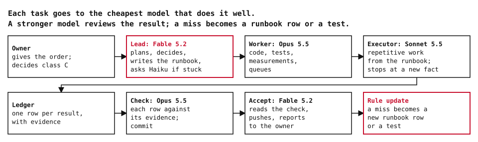

# Task routing between models

Each task goes to the cheapest model that does it well, and a stronger model reviews the result.
I introduced this routing on 2026-11-15 and added an executor on 2026-11-17.

[Polski](model-routing.pl.md)

## Who gets what

| Role | Model | Gets | Never gets |
|---|---|---|---|
| Owner | a human | every irreversible or external decision | |
| Lead | Claude Fable 5.2, max effort | plans, decisions, texts, the runbook, acceptance of results, reports to the owner | bulk work |
| Worker | Claude Opus 5.5, max effort | code, tests, measurements, proofs, queues for the executor, ledger checks | a decision that belongs to the owner |
| Executor | Claude Sonnet 5.5, high effort | repetitive work from a written runbook, for example web forms from a queue | a question the runbook does not answer |
| Hunch | Claude Haiku, max effort | one yes or no with a confidence of 1 to 99 %, when lead and worker disagree and no test exists or the test costs more than the decision | |
| Consolidation | Sonnet 5.5 and Haiku | Sonnet 5.5: night consolidation of important pages and the handoff at 15 % free context; Haiku: night consolidation of the other pages | |
| Hermes | free models | data collection, monitoring, work without Claude | |

## Rules

1. A question with one correct answer (a number, a test, a proof) goes to the worker. Every other question goes to the lead.
2. Each finished task goes to the other model for review. Evidence beats opinion: a measurement, a test or a quoted owner rule wins. A dispute lasts one round.
3. Three decision classes. A, reversible and internal: one model decides by rule 1 and reports. B, reversible but changing someone else's work, an owner arrangement or more than an hour of work: two agreeing votes of the pair decide, and a report follows. C, irreversible or external: only the owner's explicit yes.
4. No extra session and no subagent starts without the owner's order.
5. The executor works only from the runbook. A question about a fact the runbook lacks ends the task: close, report, move on.
6. Nothing the executor writes is trusted unchecked. The worker compares each ledger row with its evidence; then the lead pushes.
7. A miss found in review becomes a new runbook row or a regression test, and the test is written before the fix.

## One day in numbers (2026-11-17)

- The executor sent 12 web forms in 64 minutes (10:43 to 11:47). Each has a confirmation page recorded in the ledger.
- Cost, read from the usage file: with all three sessions active the weekly limit rose 2 points in 18 minutes. With the executor working and the other two mostly idle it rose 1 point in 19 minutes, and 3 forms went out in that time. The file has a resolution of 1 point, so the figures are rough.
- Three misses, each caught by the routing:
  - The executor answered a question whose fact the runbook lacked. The worker's ledger check found it 19 minutes later, and the runbook got a new row.
  - A collector written by an agent session stopped at 400 of 942 records and missed 14 of the 25 that mattered. The owner noticed one missing item; the fix came with a regression test.
  - A worker commit made a document generator fail for 12 of 14 templates. The lead's acceptance check caught it before the push; the fix came with a test.

## Where it lives

- Roles of the pair and the takeover of the lead: [lead-handoff](../skills/lead-handoff/SKILL.md), [drift-check](../skills/drift-check/SKILL.md), [claude-team](../skills/claude-team/SKILL.md).
- Supervision of the two sessions: [pair-watch](../tools/pair-watch/pair.py).
- Hooks that enforce limits and links: [hooks](../hooks/).
