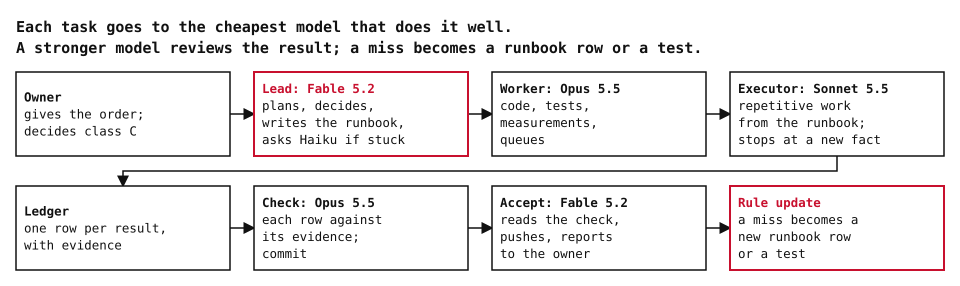

# Routing zadań między modelami

Każde zadanie dostaje najtańszy model, który wykonuje to zadanie dobrze. Wynik ocenia mocniejszy model.
Wprowadziłem ten routing 2026-11-15, a wykonawcę dodałem 2026-11-17.

[English](model-routing.md)

## Kto dostaje jaką pracę

| Rola | Model | Dostaje | Nigdy nie dostaje |
|---|---|---|---|
| Owner | człowiek | każdą decyzję nieodwracalną albo zewnętrzną | |
| Lider | Claude Fable 5.2, effort max | plany, decyzje, teksty, instrukcję wykonawcy, odbiór wyników, raport dla ownera | pracy masowej |
| Lewa półkula | Claude Opus 5.5, effort max | kod, testy, pomiary, dowody, kolejki dla wykonawcy, kontrolę rejestru | decyzji, która należy do ownera |
| Wykonawca | Claude Sonnet 5.5, effort high | pracę powtarzalną według instrukcji, na przykład formularze z kolejki | pytania, na które instrukcja nie odpowiada |
| Przeczucie | Claude Haiku, effort max | 1 odpowiedź „tak” albo „nie” z pewnością od 1 % do 99 % włącznie, gdy para ma 2 różne zdania, a test nie istnieje albo kosztuje więcej niż decyzja | |
| Konsolidacja | Sonnet 5.5 oraz Haiku | Sonnet 5.5: nocną konsolidację ważnych stron i handoff przy 15 % wolnego kontekstu; Haiku: nocną konsolidację pozostałych stron | |
| Hermes | darmowe modele | zbieranie danych, monitoring, pracę bez Claude | |

## Reguły

1. Pytanie z 1 poprawnym wynikiem (liczba, test, dowód) dostaje lewa półkula. Każde inne pytanie dostaje lider.
2. Każde skończone zadanie ocenia drugi model. Dowód wygrywa z opinią: pomiar, test albo cytat reguły ownera. Spór trwa 1 rundę.
3. Decyzje mają 3 klasy. Klasa A, odwracalna i wewnętrzna: decyduje 1 model według reguły 1 i raportuje. Klasa B, odwracalna, ale zmienia cudzą pracę, ustalenie ownera albo trwa dłużej niż 1 h: decydują 2 zgodne głosy pary, potem para raportuje. Klasa C, nieodwracalna albo zewnętrzna: tylko jawne „tak” ownera.
4. Dodatkowa sesja i subagent startują tylko na rozkaz ownera.
5. Wykonawca pracuje tylko według instrukcji. Pytanie o fakt spoza instrukcji kończy zadanie: wykonawca zamyka zadanie, raportuje i bierze kolejne.
6. Wynik wykonawcy przechodzi kontrolę. Lewa półkula porównuje każdy wiersz rejestru z dowodem; potem lider wykonuje push.
7. Błąd znaleziony w kontroli daje nowy wiersz instrukcji albo test regresji. Test powstaje przed poprawką.

## 1 dzień w liczbach (2026-11-17)

- Wykonawca wysłał 12 formularzy w 64 min, od 10:43 do 11:47 włącznie. Każdy formularz ma stronę potwierdzenia w rejestrze.
- Koszt z pliku limitów: przy 3 pracujących sesjach limit tygodniowy w 18 min wzrósł o 2 punkty procentowe. Gdy pracował głównie wykonawca, limit w 19 min wzrósł o 1 punkt procentowy, a wyszły 3 formularze. Plik ma rozdzielczość 1 punktu, więc liczby mają dokładność 1 punktu.
- 3 błędy, każdy złapany przez routing:
  - Wykonawca odpowiedział na pytanie o fakt spoza instrukcji. Kontrola rejestru znalazła błąd po 19 min, a instrukcja dostała nowy wiersz.
  - Kolektor napisany przez sesję agenta zatrzymał się na 400 z 942 rekordów i zgubił 14 z 25 potrzebnych. Owner zauważył 1 brakującą pozycję; poprawka dostała test regresji.
  - Commit lewej półkuli zepsuł generator dokumentów dla 12 z 14 szablonów. Odbiór lidera złapał błąd przed pushem; poprawka dostała test.

## Gdzie to stoi

- Role pary i przejęcie leadu: [lead-handoff](../skills/lead-handoff/SKILL.md), [drift-check](../skills/drift-check/SKILL.md), [claude-team](../skills/claude-team/SKILL.md).
- Nadzór 2 sesji: [pair-watch](../tools/pair-watch/pair.py).
- Hooki, które pilnują limitów i linków: [hooks](../hooks/).
